# Student Management REST API

REST API untuk mengelola data **siswa** dan **user** (login), dibuat dengan Node.js, Express, dan MySQL. API ini dipakai oleh aplikasi mobile Flutter di folder `../frontend`.

## Daftar Isi

1. [Deskripsi Aplikasi](#1-deskripsi-aplikasi)
2. [Teknologi yang Digunakan](#2-teknologi-yang-digunakan)
3. [Struktur Repository](#3-struktur-repository)
4. [Persiapan Sebelum Mulai](#4-persiapan-sebelum-mulai)
5. [Cara Menjalankan Backend](#5-cara-menjalankan-backend)
6. [Daftar Endpoint API](#6-daftar-endpoint-api)
7. [Identitas Pembuat](#7-identitas-pembuat)
8. [Output Pengujian API](#8-output-pengujian-api)

---

## 1. Deskripsi Aplikasi

Aplikasi ini menyediakan operasi **Create, Read, Update, dan Delete (CRUD)** untuk dua data:

- **Siswa**: NIS, nama, kelas, jurusan, alamat, foto, dan status aktif.
- **User**: nama, email, password (disimpan dalam bentuk hash bcrypt), dan status aktif. User dipakai untuk **login** dan mendapatkan token JWT.

Aplikasi mobile Flutter yang memakai API ini ada di folder [`../frontend`](../frontend/README.md).

## 2. Teknologi yang Digunakan

| Bagian | Teknologi |
|---|---|
| Backend | Node.js, Express.js |
| Database | MySQL (`mysql2`) |
| Autentikasi | JSON Web Token (`jsonwebtoken`), hash password (`bcrypt`) |
| Lainnya | CORS, dotenv |
| Testing API | Postman |

## 3. Struktur Repository

```
AppsSiswaFlutter/
├── frontend/   # aplikasi mobile Flutter
└── backend/    # REST API (dokumentasi ini)
    ├── config/         # koneksi database
    ├── src/
    │   ├── controllers/  # SiswaController, UserController
    │   ├── middlewares/  # Auth
    │   └── routes/       # SiswaRoute, UserRoute
    ├── server.js
    └── student-management.sql
```

## 4. Persiapan Sebelum Mulai

Pastikan sudah terpasang:

- **[Node.js](https://nodejs.org/)** (versi LTS), cek dengan `node -v`
- **[Git](https://git-scm.com/)**
- **MySQL** (lewat XAMPP, Laragon, atau instalasi langsung), pastikan servicenya sudah menyala
- **Postman** (untuk mencoba endpoint)

## 5. Cara Menjalankan Backend

### Langkah 1: Clone repository

```bash
git clone https://github.com/MUFArd/AppsSiswaFlutter.git
cd AppsSiswaFlutter/backend
```

### Langkah 2: Install dependency

```bash
npm install
```

### Langkah 3: Buat database

1. Buka MySQL (phpMyAdmin, HeidiSQL, atau terminal).
2. Buat database baru, misalnya `student_management`.
3. Import file `student-management.sql`, atau jalankan query berikut.

**Tabel `siswa`**

```sql
CREATE TABLE `siswa` (
	`id` INT(10) NOT NULL AUTO_INCREMENT,
	`nis` VARCHAR(50) NOT NULL DEFAULT '0' COLLATE 'utf8mb4_0900_ai_ci',
	`nama` VARCHAR(50) NULL DEFAULT '0' COLLATE 'utf8mb4_0900_ai_ci',
	`kelas` VARCHAR(50) NOT NULL DEFAULT '0' COLLATE 'utf8mb4_0900_ai_ci',
	`jurusan` VARCHAR(50) NOT NULL DEFAULT '0' COLLATE 'utf8mb4_0900_ai_ci',
	`alamat` VARCHAR(50) NOT NULL DEFAULT '0' COLLATE 'utf8mb4_0900_ai_ci',
	`foto` LONGTEXT NULL DEFAULT NULL COLLATE 'utf8mb4_0900_ai_ci',
	`is_active` ENUM('Y','N') NULL DEFAULT 'Y' COLLATE 'utf8mb4_0900_ai_ci',
	`created_at` TIMESTAMP NOT NULL DEFAULT CURRENT_TIMESTAMP,
	`updated_at` TIMESTAMP NULL DEFAULT CURRENT_TIMESTAMP ON UPDATE CURRENT_TIMESTAMP,
	`deleted_at` TIMESTAMP NULL DEFAULT NULL,
	PRIMARY KEY (`id`) USING BTREE,
	UNIQUE INDEX `nis` (`nis`) USING BTREE
)
COLLATE='utf8mb4_0900_ai_ci'
ENGINE=InnoDB;
```

**Tabel `user`**

```sql
CREATE TABLE `user` (
	`id` INT(10) NOT NULL AUTO_INCREMENT,
	`name` VARCHAR(100) NULL DEFAULT NULL COLLATE 'utf8mb4_0900_ai_ci',
	`email` VARCHAR(100) NULL DEFAULT NULL COLLATE 'utf8mb4_0900_ai_ci',
	`password` VARCHAR(255) NULL DEFAULT NULL COLLATE 'utf8mb4_0900_ai_ci',
	`is_active` ENUM('Y','N') NULL DEFAULT 'Y' COLLATE 'utf8mb4_0900_ai_ci',
	`created_at` TIMESTAMP NULL DEFAULT CURRENT_TIMESTAMP,
	`updated_at` TIMESTAMP NULL DEFAULT CURRENT_TIMESTAMP ON UPDATE CURRENT_TIMESTAMP,
	`deleted_at` TIMESTAMP NULL DEFAULT NULL,
	PRIMARY KEY (`id`) USING BTREE
)
COLLATE='utf8mb4_0900_ai_ci'
ENGINE=InnoDB;
```

> Catatan: kolom `nis` bertipe `VARCHAR`, jadi API mengirim NIS sebagai teks (contoh `"242510067"`). Kolom `is_active` berisi `Y` (aktif) atau `N` (tidak aktif).

### Langkah 4: Atur file `.env`

Buat file `.env` di folder `backend` (sejajar `package.json`). Kamu bisa menyalin dari `.env.example`, lalu isi sesuai komputer kamu:

```
DB_HOST=localhost
DB_PORT=3306
DB_USER=root
DB_PASS=
DB_NAME=student_management
PORT=3000
```

> File `.env` tidak ikut ke GitHub. Jangan pernah meng-commit password atau secret asli.

### Langkah 5: Jalankan server

```bash
node server.js
```

Atau dengan restart otomatis saat kode berubah:

```bash
npx nodemon server.js
```

Kalau di terminal muncul `Berhasil terhubung ke database`, server siap dipakai di `http://localhost:3000`.

### Langkah 6: Buat user pertama

Login membutuhkan user yang sudah ada di database. Karena password disimpan dalam bentuk hash bcrypt, **jangan mengisi password langsung lewat SQL**. Buat user lewat endpoint `POST /user` di Postman:

```json
{
    "name": "Admin",
    "email": "admin@example.com",
    "password": "rahasia123"
}
```

Setelah itu coba `POST /user/login` dengan email dan password yang sama.

### Langkah 7: Jalankan aplikasi Flutter

Setelah backend berjalan, ikuti petunjuk di [`../frontend/README.md`](../frontend/README.md). Pengaturan `baseUrl` untuk emulator dan HP asli dijelaskan di sana.

## 6. Daftar Endpoint API

### Siswa

| Method | Endpoint | Deskripsi |
|--------|----------|-----------|
| GET | `/siswa` | Mengambil seluruh data siswa |
| GET | `/siswa/:id` | Mengambil data siswa berdasarkan ID |
| POST | `/siswa` | Menambahkan data siswa baru |
| PUT | `/siswa/:id` | Mengubah data siswa |
| DELETE | `/siswa/:id` | Menghapus data siswa |

**Contoh body (POST/PUT `/siswa`):**

```json
{
    "nis": "242510067",
    "nama": "Nama Siswa",
    "kelas": "XII RPL",
    "jurusan": "Rekayasa Perangkat Lunak",
    "alamat": "Sirsak",
    "foto": "data:image/png;base64,..."
}
```

`foto` bersifat opsional.

### User

| Method | Endpoint | Deskripsi |
|--------|----------|-----------|
| POST | `/user/login` | Login dan mendapatkan token JWT |
| GET | `/user` | Mengambil seluruh data user |
| GET | `/user/:id` | Mengambil data user berdasarkan ID |
| POST | `/user` | Menambahkan user baru |
| PUT | `/user/:id` | Mengubah user (password opsional) |
| DELETE | `/user/:id` | Menghapus user |

**Contoh body login (`POST /user/login`):**

```json
{
    "email": "admin@example.com",
    "password": "rahasia123"
}
```

**Contoh body tambah user (`POST /user`):**

```json
{
    "name": "Admin",
    "email": "admin@example.com",
    "password": "rahasia123"
}
```

**Contoh body ubah user (`PUT /user/:id`):**

```json
{
    "name": "Admin Baru",
    "email": "admin@example.com",
    "is_active": "Y",
    "password": "passwordBaru123"
}
```

`password` dan `is_active` bersifat opsional. Kalau `password` tidak dikirim, password lama tidak berubah.

> Tips: coba `GET /siswa` atau `GET /user` di Postman lebih dulu untuk memastikan koneksi database berjalan, baru lanjut ke `POST`.

## 7. Identitas Pembuat

- **Nama:** Muhammad Farel Andriani
- **Kelas:** 12 RPL
- **Jurusan:** Rekayasa Perangkat Lunak
- **Proyek:** Tugas REST API, Student Management System

---

## 8. Output Pengujian API

**Link GitHub:** https://github.com/MUFArd/AppsSiswaFlutter

### Pengujian REST API Siswa

**Get semua siswa** (`GET /siswa`)

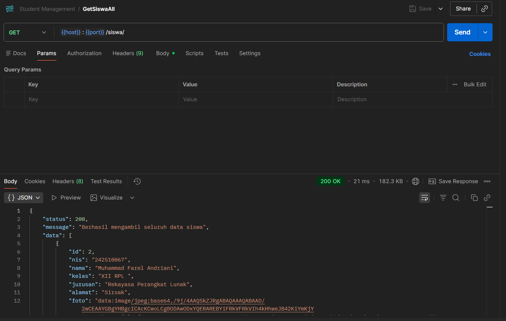

**Get siswa berdasarkan ID** (`GET /siswa/:id`)

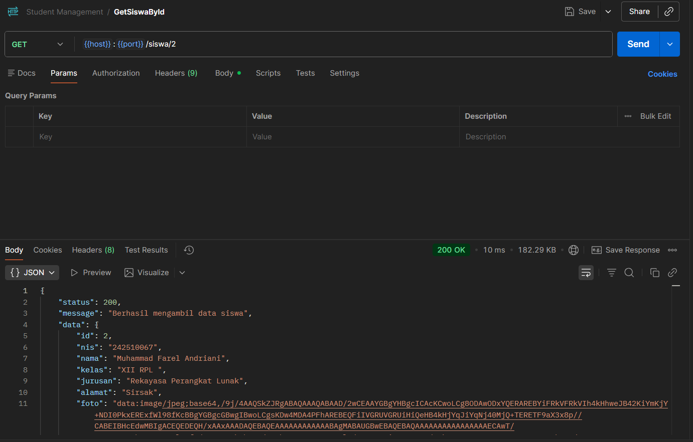

**Tambah siswa** (`POST /siswa`)

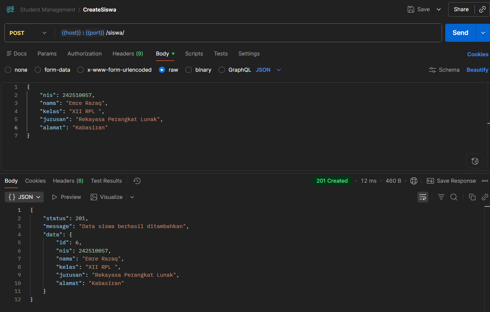

**Ubah siswa** (`PUT /siswa/:id`)

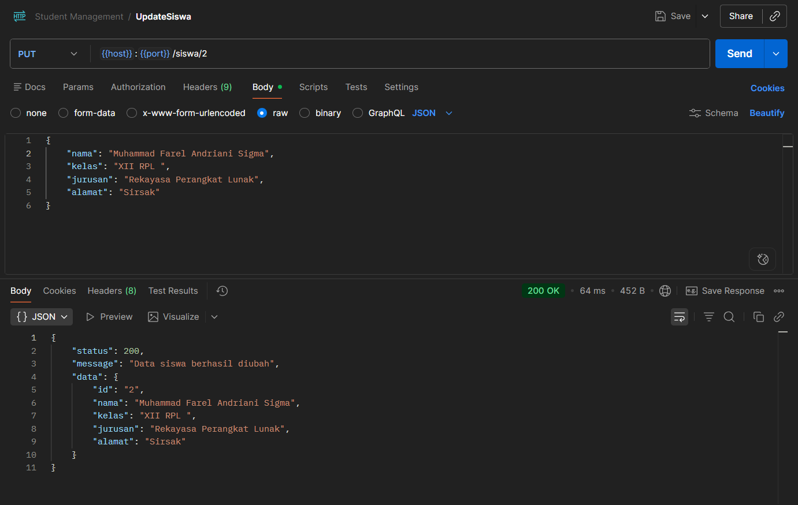

**Hapus siswa** (`DELETE /siswa/:id`)

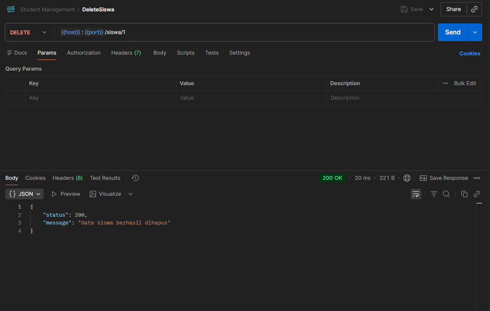

### Pengujian REST API User

**Login** (`POST /user/login`)

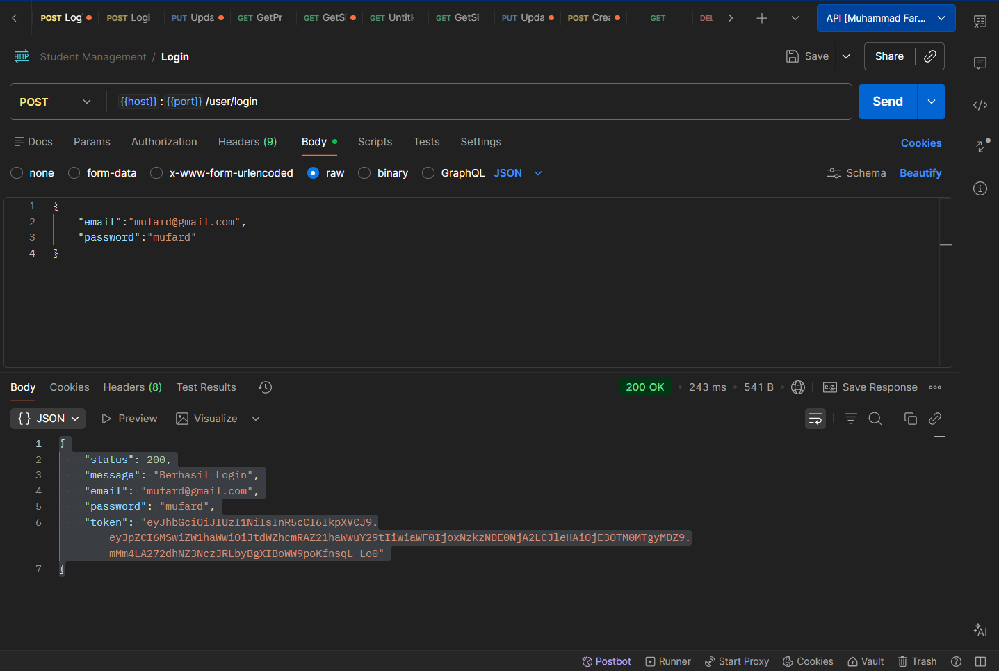

**Get semua user** (`GET /user`)

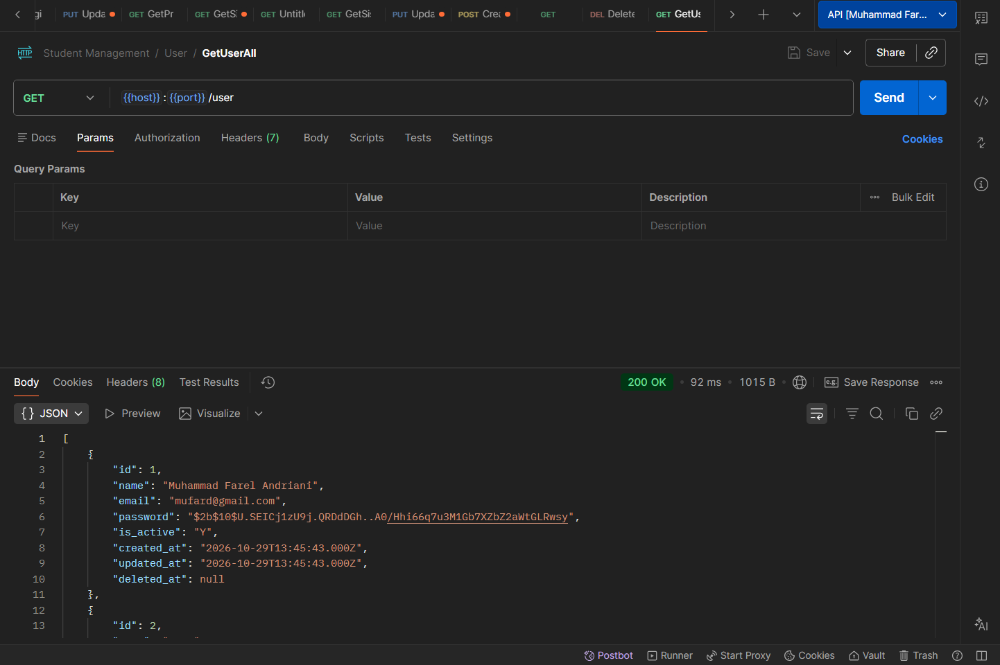

**Get user berdasarkan ID** (`GET /user/:id`)

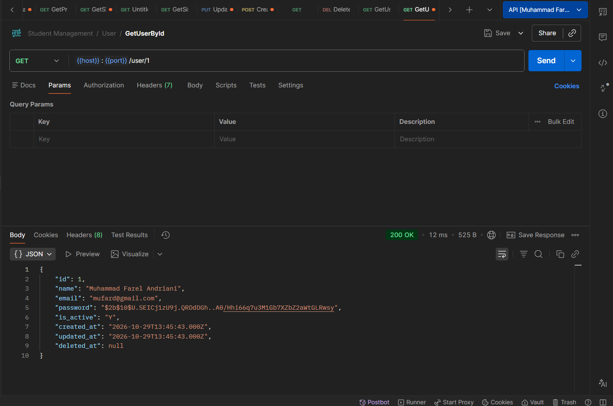

**Tambah user** (`POST /user`)

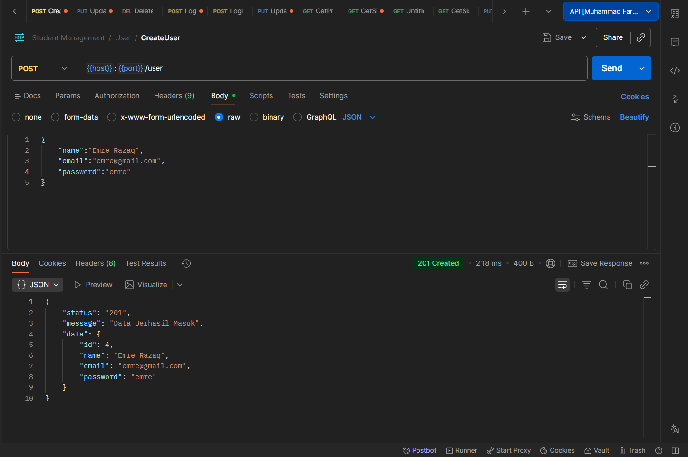

**Ubah user** (`PUT /user/:id`)

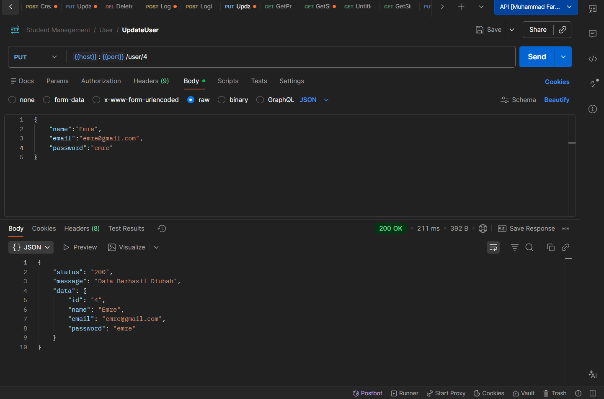

**Hapus user** (`DELETE /user/:id`)

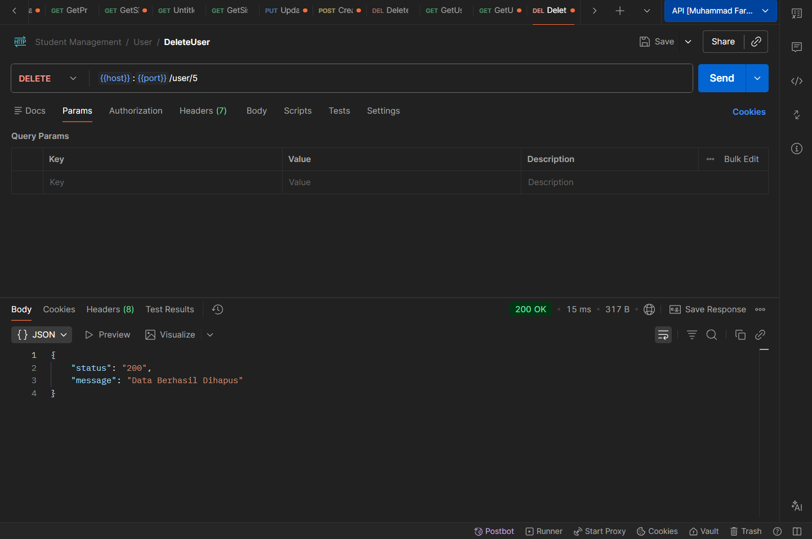

### Tampilan Aplikasi Flutter

**Siswa**

| Data Siswa | Tambah Siswa | Detail Siswa | Ubah Siswa |
|:---:|:---:|:---:|:---:|
| 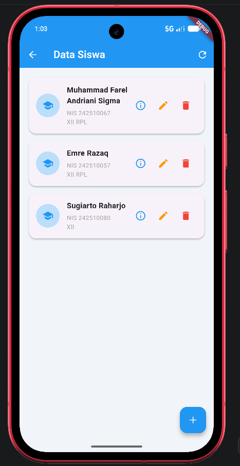 | 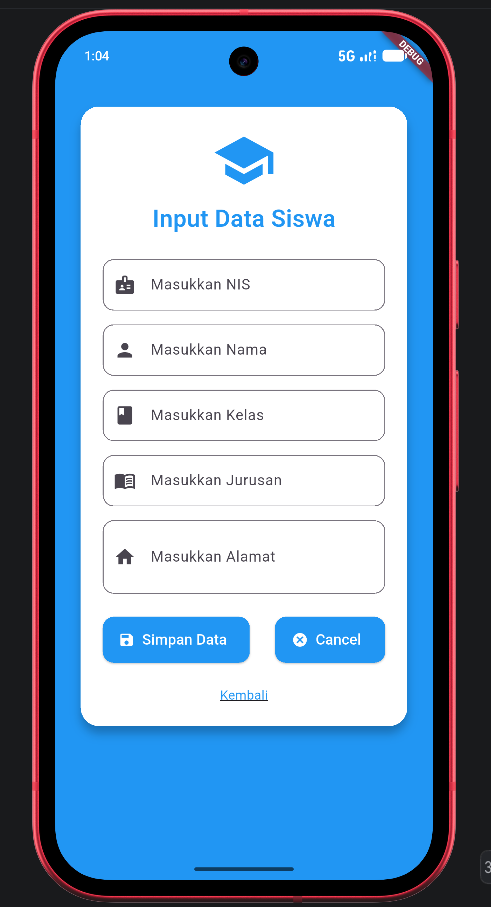 | 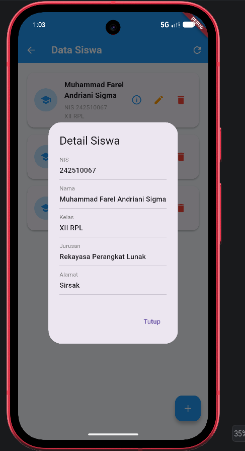 | 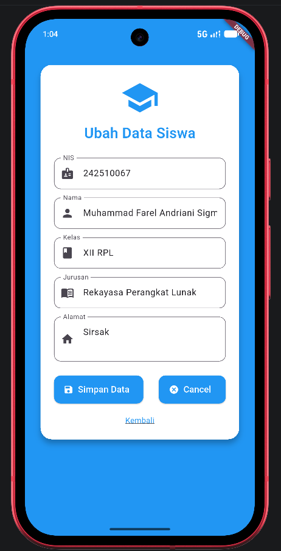 |

**User**

| Data User | Tambah User | Detail User | Ubah User |
|:---:|:---:|:---:|:---:|
| 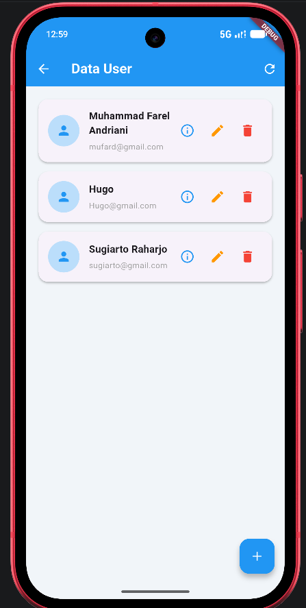 | 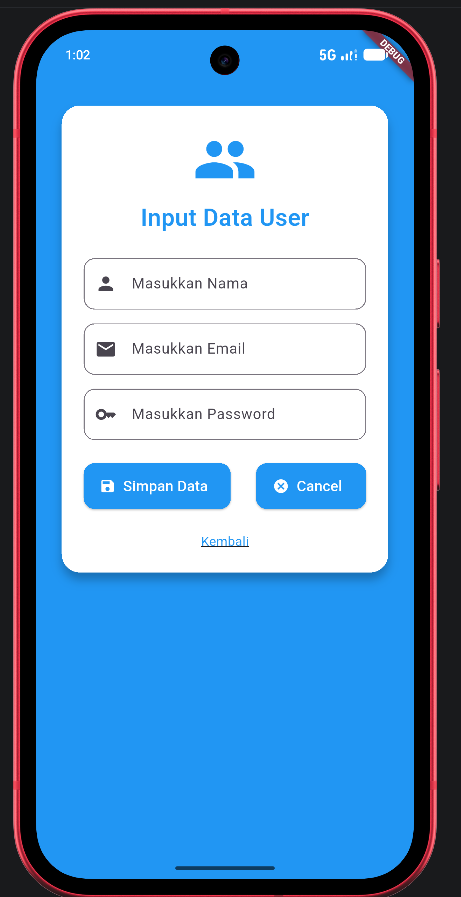 | 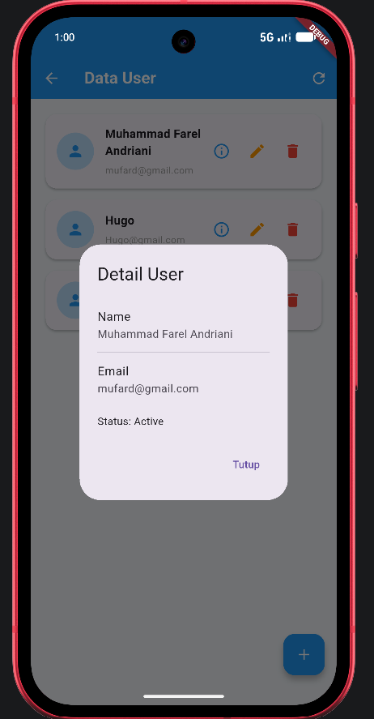 | 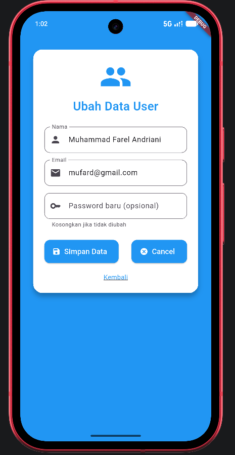 |