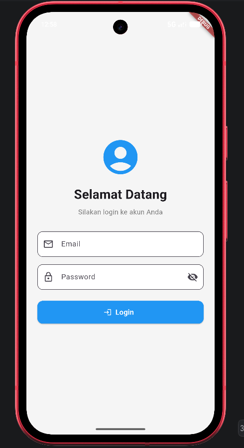
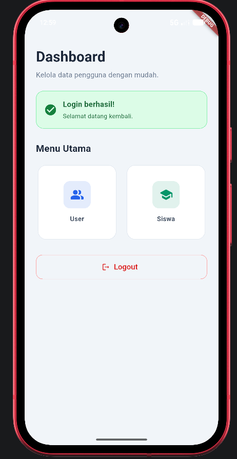
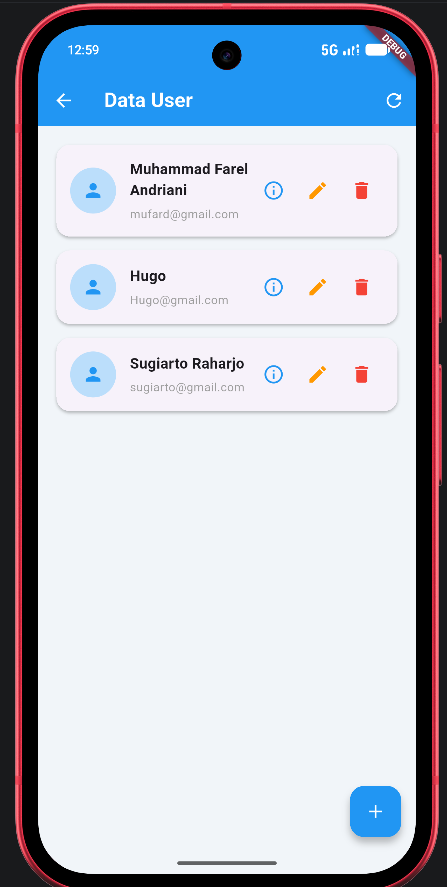
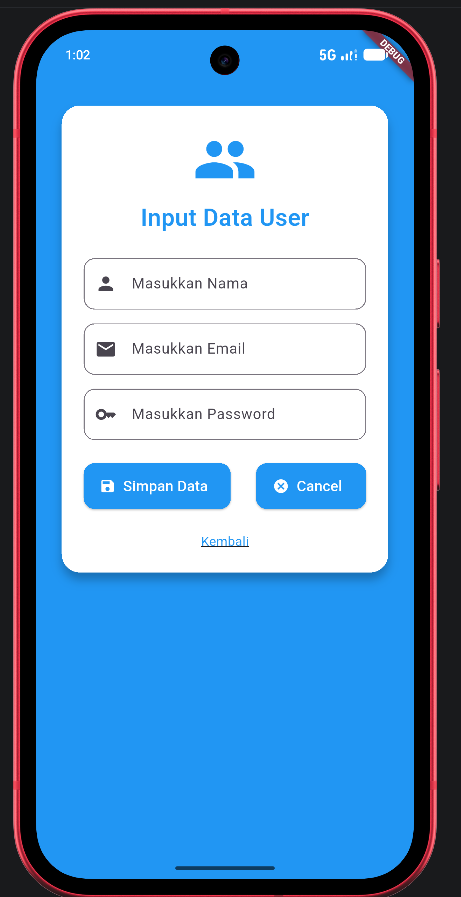
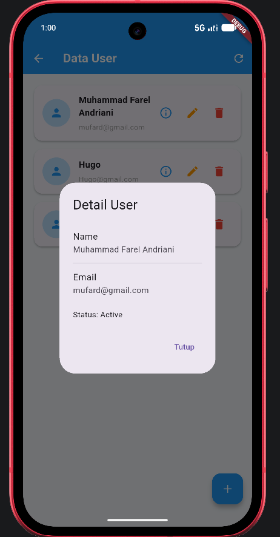
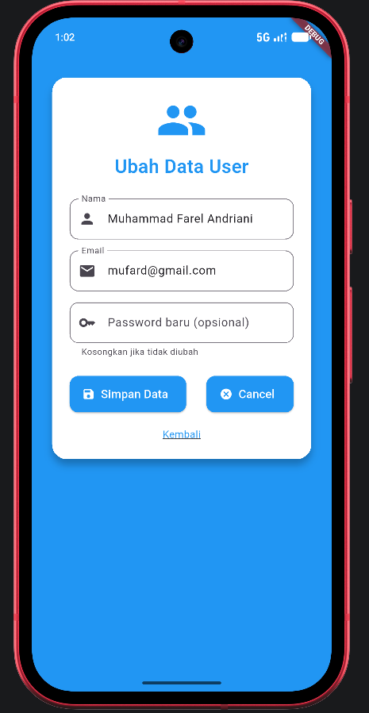
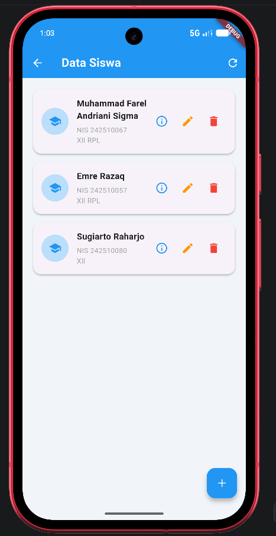
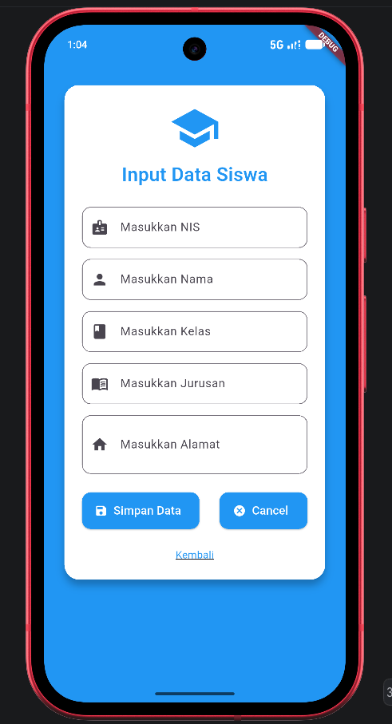
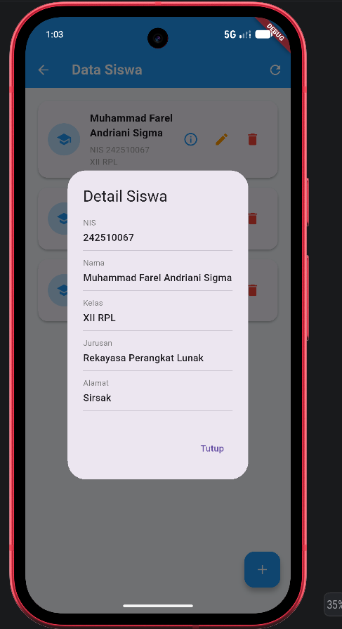
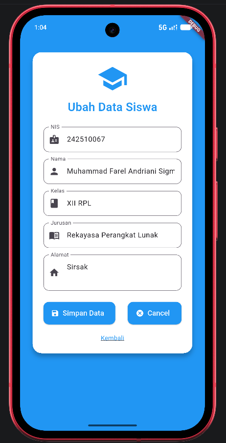

# Apps Siswa (Frontend)

Aplikasi mobile Flutter untuk mengelola data **User** dan **Siswa**. Aplikasi terhubung ke REST API (Express + MySQL) di folder `../backend`.

## Fitur

- Login menggunakan email dan password
- Dashboard dengan menu **User** dan **Siswa**
- CRUD User: lihat, tambah, ubah, hapus (termasuk status aktif Y/N)
- CRUD Siswa: lihat, tambah, ubah, hapus (NIS, nama, kelas, jurusan, alamat)
- Pull-to-refresh dan konfirmasi sebelum menghapus data

## Teknologi

- Flutter dan Dart
- Paket `http` untuk komunikasi dengan API
- Material Design

## Tampilan Aplikasi

### Login dan Dashboard

| Login | Dashboard |
|:---:|:---:|
|  |  |

### Manajemen User

| Data User | Tambah User |
|:---:|:---:|
|  |  |

| Detail User | Ubah User |
|:---:|:---:|
|  |  |

### Manajemen Siswa

| Data Siswa | Tambah Siswa |
|:---:|:---:|
|  |  |

| Detail Siswa | Ubah Siswa |
|:---:|:---:|
|  |  |

## Struktur Repository

```
AppsSiswaFlutter/
├── frontend/   # aplikasi Flutter
└── backend/    # REST API Express + MySQL
```

## Struktur Folder Frontend

```
frontend/
├── docs/         # screenshot aplikasi
└── lib/
    ├── main.dart
    ├── model/        # UserModel, SiswaModel
    ├── service/      # UserService, SiswaService (akses API)
    └── page/
        ├── LoginPage.dart
        ├── DashboardPage.dart
        ├── user/     # ReadPage, AddPage, UpdatePage
        └── siswa/    # ReadPage, AddPage, UpdatePage
```

## Persyaratan

- Git
- Flutter SDK (cek dengan `flutter doctor`)
- Node.js dan npm
- MySQL (misalnya lewat XAMPP)
- Android Studio atau VS Code
- Android Emulator atau HP Android dengan USB debugging

## Clone Repository

```bash
git clone https://github.com/MUFArd/AppsSiswaFlutter.git
cd AppsSiswaFlutter
```

## Menyiapkan Backend

```bash
cd backend
npm install
```

1. Jalankan MySQL, lalu buat database dan import file `.sql` dari folder `backend` (jika tersedia).
2. Buat file `.env` di folder `backend` (salin dari `.env.example`), lalu isi sesuai komputer kamu.
3. Jalankan server:

   ```bash
   nodemon server.js
   ```

   Atau tanpa nodemon:

   ```bash
   node server.js
   ```

Server berjalan di `http://localhost:3000`. Kalau di terminal muncul `Berhasil terhubung ke database`, backend sudah siap.

## Menjalankan Frontend

1. Pastikan backend sudah berjalan.
2. Buka terminal baru, lalu pasang dependency:

   ```bash
   cd frontend
   flutter pub get
   ```

3. Atur `baseUrl` di `lib/service/UserService.dart` dan `lib/service/SiswaService.dart` sesuai perangkat:

   | Perangkat | baseUrl |
   |---|---|
   | Emulator Android | `http://10.0.2.2:3000` |
   | Emulator + `adb reverse` | `http://127.0.0.1:3000` |
   | HP asli (satu Wi-Fi dengan laptop) | `http://IP_LAPTOP:3000` |

4. Jalankan aplikasi:

   ```bash
   flutter run
   ```

## Troubleshooting

**`Network is unreachable (errno = 101)` di emulator**

Jaringan emulator bermasalah. Jalankan perintah ini (emulator harus sudah menyala), lalu ubah `baseUrl` ke `http://127.0.0.1:3000`:

```bash
adb reverse tcp:3000 tcp:3000
```

Perintah ini perlu diulang setiap emulator di-restart. Kalau `adb` tidak dikenali, pakai path lengkap, misalnya `C:\Android\Sdk\platform-tools\adb.exe`.

**`Connection refused` atau timeout**

Pastikan server Express berjalan di port 3000 dan MySQL aktif. Untuk HP asli, izinkan Node.js di Windows Firewall.

**Server backend crash (`PROTOCOL_CONNECTION_LOST`)**

MySQL berhenti atau koneksi terputus. Pastikan MySQL running, lalu restart server (`rs` di terminal nodemon).

**`LateInitializationError` setelah mengubah kode**

Lakukan **Hot Restart** atau stop lalu run ulang. Hot reload biasa tidak menjalankan ulang `initState()`.

**Perubahan `baseUrl` tidak terbaca**

`baseUrl` bertipe `static const`, jadi aplikasi harus di-stop lalu di-run ulang.

## Endpoint yang Dipakai

| Method | Endpoint | Fungsi |
|---|---|---|
| POST | `/user/login` | Login |
| GET, POST | `/user` | Daftar dan tambah user |
| PUT, DELETE | `/user/:id` | Ubah dan hapus user |
| GET, POST | `/siswa` | Daftar dan tambah siswa |
| PUT, DELETE | `/siswa/:id` | Ubah dan hapus siswa |

Dokumentasi lengkap API ada di folder `backend`.

## Author

[MUFArd / Muhammad Farel Andriani](https://github.com/MUFArd)
[raharjosugiarto4 / Sugiarto Raharjo](https://github.com/raharjosugiarto4)
